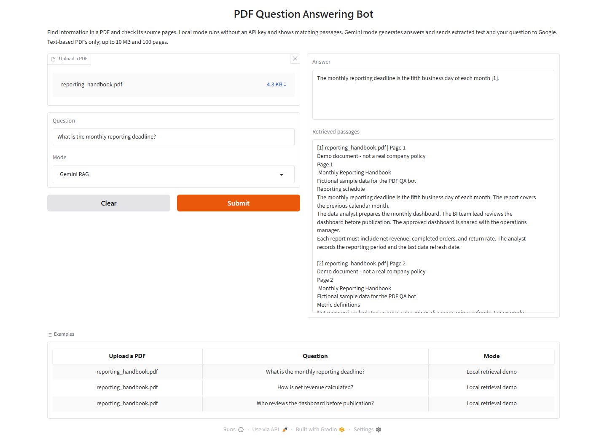

# PDF Question Answering Bot

**Small RAG application** · [Portfolio](https://github.com/MohammadKhairJaradat) · [CV](https://github.com/MohammadKhairJaradat/MohammadKhairJaradat/blob/main/Mohammad_Khair_Jaradat_CV.pdf)

A Python app for asking questions about PDF documents. It uses retrieval-augmented generation (RAG) with Google Gemini and shows the supporting passages with page numbers.

**Stack:** Python · LangChain · Chroma · Gemini API · Gradio



## Features

- Upload a PDF and ask questions about its content.
- Retrieve relevant text using overlapping chunks and semantic embeddings.
- Generate answers with numbered source references in Gemini mode.
- Try local retrieval without an API key.
- Handle invalid inputs, unreadable PDFs, and provider failures.

```text
PDF → page text → chunks → embeddings → Chroma
Question → relevant passages → Gemini → answer + source pages
```

| Mode | Retrieval | Output | API key |
| --- | --- | --- | --- |
| Gemini RAG | Gemini semantic embeddings | Generated answer and source passages | Required |
| Local retrieval demo | TF-IDF word vectors | Matching passages only | Not required |

## Run locally

Use **Python 3.12**. From the project folder on Windows:

```powershell
python -m venv .venv
.venv\Scripts\python.exe -m pip install -r requirements.txt
.venv\Scripts\python.exe app.py
```

On macOS or Linux, use `.venv/bin/python` instead of `.venv\Scripts\python.exe`.

Open [http://127.0.0.1:7860](http://127.0.0.1:7860). Choose **Local retrieval demo** to try the app without a key. Click an example to load the included fictional reporting handbook, then select **Submit**.

### Enable Gemini

Copy `.env.example` to `.env`. Add a key from [Google AI Studio](https://aistudio.google.com/apikey):

```dotenv
GOOGLE_API_KEY=your_api_key
GEMINI_CHAT_MODEL=gemini-3.1-flash-lite
GEMINI_EMBEDDING_MODEL=gemini-embedding-001
```

Select **Gemini RAG** in the app. Configuration is read on each request, so changes to `.env` do not require a restart. Existing environment variables take precedence over `.env`.

Model access, quotas, and cost depend on your Google project. See Google's [model list](https://ai.google.dev/gemini-api/docs/models) and [API pricing](https://ai.google.dev/gemini-api/docs/pricing).

## Try the sample

Use `sample_data/reporting_handbook.pdf`:

| Question | Expected evidence |
| --- | --- |
| What is the monthly reporting deadline? | Fifth business day, page 1 |
| Who reviews the dashboard before publication? | BI team lead, page 1 |
| How is net revenue calculated? | Gross sales minus discounts minus refunds, page 2 |
| How should duplicate order records be handled? | Keep the latest record for each order_id, page 3 |

## Project structure

```text
app.py                         Gradio interface
qa_bot.py                      PDF processing, retrieval, and generation
sample_data/reporting_handbook.pdf
assets/gemini-demo.png         App screenshot
scripts/create_sample_pdf.py   Sample PDF generator
tests/test_qa_bot.py            Offline tests
.github/workflows/tests.yml    GitHub Actions test workflow
.env.example                   Configuration template
```

## Tests

```powershell
.venv\Scripts\python.exe -m pip install -r requirements-dev.txt
.venv\Scripts\python.exe -m pytest -q
```

The **35 offline tests** cover extraction, chunk metadata, known-answer retrieval, file replacement, size limits, source references, collection cleanup, and safe error messages. They use test doubles for generation and do not call the Gemini API. GitHub Actions is configured to run them on pushes and pull requests.

Live validation on October 13, 2026 covered three supported questions and one question with no answer in a two-page Python reference PDF. The fictional handbook's browser flow was rechecked on October 14 with a correct answer and source page. Additional requests encountered temporary Google service errors (HTTP 503). These manual checks demonstrate the workflow; they are not a general accuracy benchmark.

## Limitations

- One text-based PDF per request: up to 10 MB, 100 pages, and 300 chunks. No OCR or encrypted PDFs.
- The vector collection is rebuilt and deleted for each question. This avoids stale results but repeats embedding requests in Gemini mode.
- TF-IDF has limited paraphrase support. Retrieval can miss relevant passages, and generated answers still need human verification.
- Empty model responses and references to unavailable passages are rejected. A valid reference number does not prove that the answer is correct.
- Gemini mode sends extracted text and questions to Google. Local mode makes no model API calls. `.env` is excluded from Git.
- The app runs on localhost. Gradio may keep temporary upload files, and cloud requests can fail when quota is exhausted or the service is busy.

Inspired by a PDF QA lab in the [IBM AI Engineering Professional Certificate](https://coursera.org/verify/professional-cert/DY3SM13IY132), completed in October 2026; developed as an independent portfolio project.
