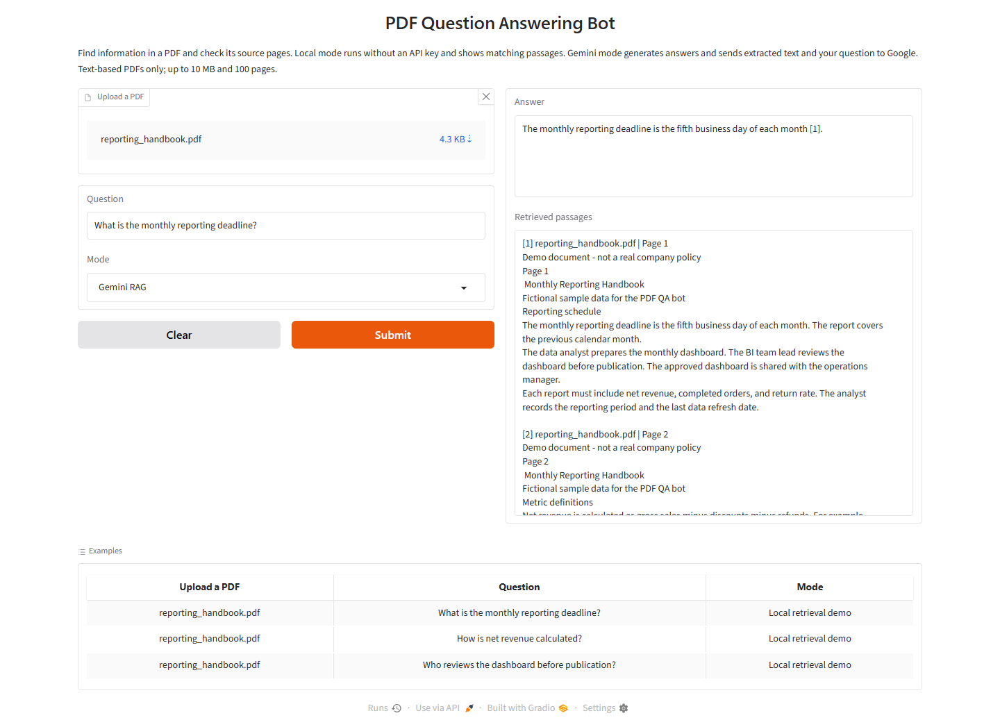
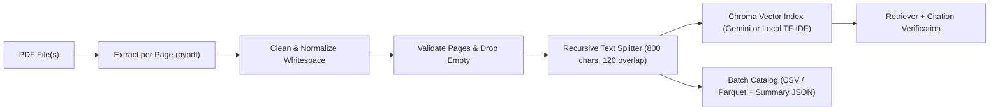

# PDF Question Answering Bot

**Small RAG application & PDF ingestion pipeline** · [Portfolio](https://github.com/MohammadKhairJaradat) · [CV](https://github.com/MohammadKhairJaradat/MohammadKhairJaradat/blob/main/Mohammad_Khair_Jaradat_CV.pdf)

A Python application and batch ingestion pipeline for asking questions about PDF documents. It extracts, cleans, validates, and chunks PDF pages with page-level lineage, then answers questions using retrieval-augmented generation (RAG) with Google Gemini or offline TF-IDF retrieval.

**Stack:** Python · LangChain · Chroma · Gemini API · Gradio · pypdf



## Features

- Upload a PDF and ask questions about its content with page-level citations.
- Explicit, logged document ingestion stages: page extraction → whitespace normalization → data-quality validation → overlapping chunking → indexing.
- Batch ingestion CLI (`ingest.py`) with SHA-256 manifest idempotency that skips unchanged files and exports a chunk catalog (`chunks.csv`, `chunks.parquet`) plus an ingestion validation summary (`ingestion_summary.json`).
- Retrieve relevant text using semantic embeddings (Gemini) or try local retrieval (`TfidfVectorizer`) without an API key.
- Handle invalid inputs, blank/scanned pages, unreadable PDFs, and provider failures safely.

## Architecture & Ingestion Pipeline



### Ingestion Stages & Validation Checks

Both interactive Q&A (`qa_bot.py`) and batch CLI (`ingest.py`) run the same explicit document pipeline:

1. **File & Constraint Validation**: Rejects missing files, non-PDF extensions, encrypted PDFs, files over 10 MB, or PDFs exceeding 100 pages. Computes a `file_sha256` fingerprint for lineage and idempotent reruns.
2. **Page Extraction & Normalization (`extract_pdf_pages` / `clean_page_text`)**: Extracts text per 1-indexed page and collapses redundant horizontal whitespace while preserving line structure.
3. **Empty/Scanned Page Detection**: Flags and skips blank or scanned pages (`empty_pages_skipped`), raising a clear error if an entire PDF contains no readable text.
4. **Chunking & Post-Split Filtering (`text_splitter`)**: Splits documents into 800-character chunks (120-character overlap), drops any whitespace-only chunks, enforces a 300-chunk ceiling, and records `chunks_created` in the ingestion summary (`pages_total`, `pages_with_text`, `empty_pages_skipped`, `chunks_created`, `file_sha256`).

| Mode | Retrieval | Output | API key |
| --- | --- | --- | --- |
| Gemini RAG | Gemini semantic embeddings | Generated answer and source passages | Required |
| Local retrieval demo | TF-IDF word vectors | Matching passages only | Not required |

## Run locally

Use **Python 3.12**. From the project folder on Windows:

```powershell
python -m venv .venv
.venv\Scripts\python.exe -m pip install -r requirements.txt
.venv\Scripts\python.exe app.py
```

On macOS or Linux, use `.venv/bin/python` instead of `.venv\Scripts\python.exe`.

Open [http://127.0.0.1:7860](http://127.0.0.1:7860). Choose **Local retrieval demo** to try the app without a key. Click an example to load the included fictional reporting handbook, then select **Submit**.

### Batch Ingestion CLI

Run `ingest.py` to process a single PDF or a directory of PDFs into a structured chunk catalog:

```powershell
.venv\Scripts\python.exe ingest.py sample_data/ --output-dir data/processed
```

- **Idempotent reruns**: Recorded SHA-256 hashes in `data/processed/manifest.json` allow subsequent runs to skip unchanged PDFs automatically (pass `--force` to re-ingest).
- **Outputs**:
  - `data/processed/chunks.csv` (and `chunks.parquet` when `pandas`/`pyarrow` are present in the environment) with columns `source`, `file_sha256`, `page`, `chunk_index`, `char_count`, `word_count`, and `text`.
  - `data/processed/ingestion_summary.json` recording discovered, ingested, skipped, and failed file counts along per-file page/chunk validation metrics.

Sample run on `sample_data/reporting_handbook.pdf` (`sha256: 3f18c8f6b1fa...`):
- `pages_total`: 3, `pages_with_text`: 3, `empty_pages_skipped`: 0, `chunks_created`: 3.
- Rerun on unchanged directory: `files_ingested`: 0, `files_skipped_unchanged`: 1, `total_chunks_in_catalog`: 3.

### Enable Gemini

Copy `.env.example` to `.env`. Add a key from [Google AI Studio](https://aistudio.google.com/apikey):

```dotenv
GOOGLE_API_KEY=your_api_key
GEMINI_CHAT_MODEL=gemini-3.1-flash-lite
GEMINI_EMBEDDING_MODEL=gemini-embedding-001
```

Select **Gemini RAG** in the app. Configuration is read on each request, so changes to `.env` do not require a restart. Existing environment variables take precedence over `.env`.

Model access, quotas, and cost depend on your Google project. See Google's [model list](https://ai.google.dev/gemini-api/docs/models) and [API pricing](https://ai.google.dev/gemini-api/docs/pricing).

## Try the sample

Use `sample_data/reporting_handbook.pdf`:

| Question | Expected evidence |
| --- | --- |
| What is the monthly reporting deadline? | Fifth business day, page 1 |
| Who reviews the dashboard before publication? | BI team lead, page 1 |
| How is net revenue calculated? | Gross sales minus discounts minus refunds, page 2 |
| How should duplicate order records be handled? | Keep the latest record for each order_id, page 3 |

## Project structure

```text
app.py                         Gradio interface
qa_bot.py                      PDF extraction, validation, chunking, retrieval, and generation
ingest.py                      Batch PDF ingestion CLI with SHA-256 manifest and CSV/Parquet export
sample_data/reporting_handbook.pdf
assets/gemini-demo.png         App screenshot
scripts/create_sample_pdf.py   Sample PDF generator
tests/test_qa_bot.py           Offline unit & ingestion tests
.github/workflows/tests.yml    GitHub Actions test workflow
.env.example                   Configuration template
```

## Tests

```powershell
.venv\Scripts\python.exe -m pip install -r requirements-dev.txt
.venv\Scripts\python.exe -m pytest -q
```

The **37 offline tests** cover extraction, whitespace normalization, empty-page tracking, chunk metadata, batch CLI manifest idempotency, known-answer retrieval, file replacement, size limits, source references, collection cleanup, and safe error messages. They use test doubles for generation and do not call the Gemini API. GitHub Actions is configured to run them on pushes and pull requests.

All **37 tests passed** in Python 3.12 (`5.08s`). This count measures automated checks, not answer accuracy on arbitrary documents.

Live validation on October 13, 2026 covered three supported questions and one question with no answer in a two-page Python reference PDF. The fictional handbook's browser flow was rechecked on October 14 with a correct answer and source page. Additional requests encountered temporary Google service errors (HTTP 503). These manual checks demonstrate the workflow; they are not a general accuracy benchmark.

## Limitations

- Interactive mode processes one text-based PDF per request: up to 10 MB, 100 pages, and 300 chunks. No OCR or encrypted PDFs.
- In interactive Q&A, the vector collection is rebuilt and deleted for each question. This avoids stale results but repeats embedding requests in Gemini mode.
- TF-IDF has limited paraphrase support. Retrieval can miss relevant passages, and generated answers still need human verification.
- Empty model responses and references to unavailable passages are rejected. A valid reference number does not prove that the answer is correct.
- Gemini mode sends extracted text and questions to Google. Local mode makes no model API calls. `.env` is excluded from Git.
- The app runs on localhost. Gradio may keep temporary upload files, and cloud requests can fail when quota is exhausted or the service is busy.

Inspired by a PDF QA lab in the [IBM AI Engineering Professional Certificate](https://coursera.org/verify/professional-cert/DY3SM13IY132), completed in October 2026; developed as an independent portfolio project.

## Contact

[Email Mohammad Khair Jaradat](mailto:mohammad.sameer.jaradat@gmail.com) · [GitHub profile](https://github.com/MohammadKhairJaradat) · [CV](https://github.com/MohammadKhairJaradat/MohammadKhairJaradat/blob/main/Mohammad_Khair_Jaradat_CV.pdf)
